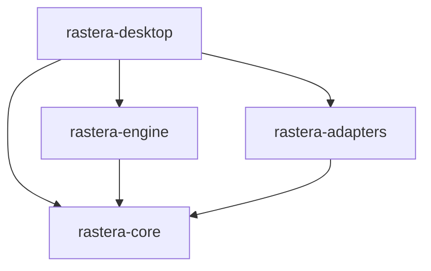
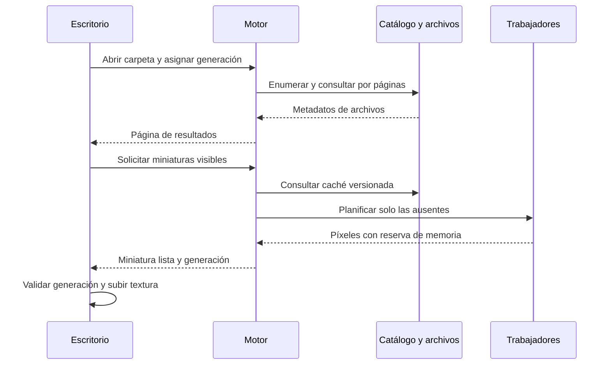

# Arquitectura de Rastera

Las secciones de implementación actual describen el código disponible. El resto del documento mantiene el diseño objetivo y puede incluir capacidades todavía pendientes.

## Implementación actual de los lotes y la memoria

El motor tiene un trabajador de visor, uno de miniaturas y uno de exportación, además de los trabajadores de escaneo y catálogo. No hay todavía un pool central adaptativo. Las colas de resultados de imágenes admiten un elemento y retienen su reserva hasta entregarlo a la UI; el progreso del lote admite cuatro eventos.

Los tres trabajadores de imágenes comparten 512 MiB de reservas. El visor y las miniaturas estiman 16 bytes por píxel de entrada; la exportación estima 32. Cuando la memoria está ocupada, los trabajadores esperan con cancelación fuera del hilo gráfico. El lote da preferencia al visor entre archivos. No se interrumpe una llamada de códec en curso. Las estimaciones no representan la memoria total del proceso.

El plan de exportación valida entradas, orientación, dimensiones finales, nombres equivalentes y colisiones. La ejecución trabaja sobre el original, aplica EXIF una vez, rota, reduce sin ampliar y convierte. Admite SDR de 8 bits sin ICC, asume sRGB y rechaza declaraciones PNG de color no compatibles. La interfaz exige aceptar la eliminación de metadatos y muestra fondo/calidad JPEG.

Cada lote mantiene un diario SQLite independiente en el destino con intención, temporales y estados pending, encoding, ready, published, error y cancelled. Las salidas se sincronizan y se publican sin reemplazo mediante tempfile::persist_noclobber. Las colisiones que aparecen después del plan también fallan sin sobrescribir. Los errores individuales continúan; un error del diario detiene el lote. Una publicación cuya confirmación falla se comunica como publicada y pendiente de revisión.

La recuperación automática, los hashes de identidad, la reanudación y las mediciones de rendimiento siguen pendientes. Tamaño y fecha de modificación detectan cambios habituales, sin demostrar igualdad de contenido. No se promete atomicidad del lote ni persistencia ante una pérdida de alimentación.

## Implementación actual del catálogo

SQLite se abre y utiliza exclusivamente en un trabajador con colas de 32 mensajes. El cierre drena las escrituras aceptadas. Se guarda en el directorio de datos de usuario: en Windows, %LOCALAPPDATA%\Rastera\catalog.sqlite. Las claves de ruta usan UTF-16 sin pérdida en Windows y bytes en Unix; el texto visible no identifica los archivos.

El esquema v1 almacena favoritos, hasta 32 etiquetas y dimensiones/formato de las imágenes abiertas. Las anotaciones de la carpeta (máximo 10.000 rutas) se consultan fuera del hilo gráfico. La búsqueda por nombre/etiqueta y los filtros de favoritos/formato operan sobre la carpeta abierta y se recalculan al cambiar sus datos. No es todavía una búsqueda global del catálogo.

La versión del esquema se comprueba antes de escribir. Una base de una versión más reciente se rechaza; antes de migrar una base existente se crea una copia mediante la API de backup de SQLite, y la migración es transaccional. Los errores permiten seguir usando el visor y la cuadrícula. La observación de archivos, la reconciliación automática y el seguimiento de renombrados siguen pendientes: Actualizar vuelve a leer la carpeta, y una ruta nueva tiene identidad distinta.

Estado: diseño inicial para implementar. Fecha: 10 de octubre de 2026.

Rastera será una aplicación de escritorio para visualizar, organizar y transformar imágenes locales. La arquitectura separa el hilo de interfaz del acceso a archivos, la decodificación y los lotes. Todas las tareas que puedan acumular imágenes deberán pasar por un planificador con límites de cola, concurrencia y memoria.

## Alcance inicial

La primera versión se desarrollará para Windows y abrirá carpetas sin importar ni copiar sus originales. Cubrirá JPEG, PNG y WebP estáticos; los archivos animados deberán identificarse y mostrarse como no compatibles en esta fase.

El visor incluirá cuadrícula, selección, zoom, desplazamiento y navegación con teclado. La organización añadirá favoritos, etiquetas y búsqueda. Los lotes exportarán copias con redimensionado, rotación y conversión. El renombrado del original se añadirá después de implementar el registro de operaciones y su recuperación.

RAW, HDR, animaciones, reconocimiento mediante IA, sincronización en la nube y edición por capas quedan para fases posteriores. La interfaz será nativa compilada, con controles dibujados por egui; esto no implica que use los controles visuales propios de Windows.

## Principios de diseño

- El hilo de interfaz nunca espera a un decodificador, al disco o a una consulta de catálogo.
- La imagen seleccionada tiene prioridad sobre miniaturas, precarga y lotes.
- La biblioteca puede crecer sin que crezca proporcionalmente la cantidad de píxeles residentes en memoria.
- Las operaciones se pueden cancelar y los resultados antiguos no cambian la vista actual.
- Los originales se conservan durante las exportaciones. Los cambios de nombre se registran antes de ejecutarse.
- Los algoritmos de producto se comparten entre los puntos de entrada, sin depender de widgets.
- Los límites y las mejoras de rendimiento se verifican con datos medidos.

## Componentes y dependencias

El workspace y los cuatro componentes ya existen. La siguiente estructura incluye también los directorios de fixtures y benchmarks previstos para las siguientes fases.

```text
rastera/
├── Cargo.toml
├── Cargo.lock
├── crates/
│   ├── rastera-desktop/     # Ventana, vistas, entrada y composición
│   ├── rastera-core/        # Modelos, comandos, eventos y contratos
│   ├── rastera-engine/      # Casos de uso, planificación y presupuestos
│   └── rastera-adapters/    # Archivos, SQLite, códecs e integración del SO
├── docs/
│   ├── architecture.md
│   └── roadmap.md
├── tests/fixtures/          # Imágenes pequeñas y resultados esperados
└── benches/                # Mediciones reproducibles
```



Las flechas representan dependencias de compilación. `rastera-desktop` construye los adaptadores y los entrega al motor mediante contratos de `rastera-core`. En ejecución, el motor invoca esos contratos. El motor y los adaptadores no dependen entre sí, y ningún componente inferior importa la interfaz.

| Componente | Responsabilidad | Límite |
| --- | --- | --- |
| `rastera-desktop` | Estado visual, atajos, cuadrícula virtualizada, visor y texturas GPU | No decodifica archivos ni ejecuta SQL durante un frame |
| `rastera-core` | Identidades, versiones, recetas, estados de trabajo y contratos de almacenamiento y procesamiento | No depende de egui, SQLite ni de un runtime |
| `rastera-engine` | Enumerar bibliotecas, pedir miniaturas, ejecutar recetas y coordinar lotes | No conoce widgets, handles GPU ni SQL |
| `rastera-adapters` | Implementar contratos con archivos, códecs, SQLite, caché en disco y servicios del SO | No decide la navegación ni las prioridades del producto |

Los contratos cubrirán operaciones concretas como consultar páginas del catálogo, enumerar archivos, inspeccionar una imagen y exportar una receta. No se creará una abstracción genérica para cada llamada del sistema. La futura CLI será otro punto de composición que utilizará el mismo motor.

## Tecnologías previstas

| Área | Elección inicial | Motivo y condición |
| --- | --- | --- |
| Lenguaje | Rust estable y workspace de Cargo | Compartir tipos y fijar dependencias mediante `Cargo.lock` |
| Interfaz | `egui` y `eframe` con backend `wgpu` | Ventana y renderizado nativos; validar accesibilidad y consumo en reposo en el prototipo |
| Códecs y transformaciones | `image`, con formatos habilitados explícitamente | Base para JPEG, PNG y WebP; comprobar límites, orientación y capacidades de cada códec |
| Catálogo | SQLite mediante `rusqlite` | Persistencia local, índices y migraciones versionadas |
| Concurrencia | Hilos de trabajo y canales acotados mediante `crossbeam-channel` | Carga principalmente local; evitar un runtime asíncrono sin necesidad |
| Cambios en carpetas | `notify` y reconciliación mediante escaneo | Los eventos son avisos; no sustituyen una comprobación del estado del disco |
| Configuración | `serde` y TOML | Preferencias legibles y esquema versionado |
| Diagnóstico | `tracing` | Medir colas, decodificación, cachés y exportaciones |

No se fijan versiones de bibliotecas en este diseño. La primera implementación elegirá versiones compatibles, declarará la versión mínima de Rust y conservará el lockfile. Cualquier paralelismo interno de un códec se tendrá en cuenta para evitar multiplicar los hilos del planificador.

Los contratos permitirán sustituir un códec cuando haya una necesidad medida. La aplicación se escribirá en Rust, pero no se presupone que todas sus dependencias del sistema o de terceros estén escritas exclusivamente en Rust.

## Interfaz y comunicación

Un único hilo posee el estado visual y los handles de textura de egui. Envía comandos al motor y recibe eventos sin bloquear. Los comandos contienen identificadores y parámetros, no copias de los originales.

Cada navegación crea una generación de vista. Las peticiones de miniaturas y previsualizaciones llevan esa generación, la identidad del archivo y su versión observada. Un resultado de una carpeta anterior puede servir a una caché válida, pero nunca reemplaza el contenido de la vista actual.

Los eventos incluirán páginas del catálogo, miniaturas disponibles, previsualizaciones listas, progreso y errores por archivo. Las respuestas que transporten píxeles mantendrán una reserva de memoria hasta que el receptor los libere. El progreso se agrupa por intervalo o mediante el último estado disponible; no se crea un evento por píxel ni una acumulación sin límite.

La cuadrícula construye únicamente las filas visibles y un margen pequeño. Las consultas devuelven páginas con orden estable y desempate por identificador. Ni la UI ni el canal de resultados almacenan la biblioteca entera. El tamaño total y la selección se representan mediante consultas o identificadores, no mediante imágenes decodificadas.

La ventana pide repintado cuando hay interacción o un resultado relevante. No mantiene un bucle de animación continuo cuando está en reposo; el progreso y los efectos visuales deben respetar esta regla.

## Flujo de visualización



La primera cuadrícula aparece de forma progresiva, sin esperar a terminar la indexación. El modo de carpeta funciona aunque el catálogo no esté disponible; favoritos, etiquetas y búsquedas persistentes requieren recuperar el catálogo.

El visor presenta primero una previsualización ajustada a la ventana. La resolución completa se solicita cuando el zoom lo requiere y los presupuestos lo permiten. Reducir una imagen después de decodificarla no evita necesariamente el pico de memoria de la decodificación: solo se usará decodificación reducida cuando el códec la soporte y se haya validado.

La precarga de las imágenes vecinas es opcional y se cancela al cambiar de dirección o entrar en presión de memoria. Una imagen que supere los límites tendrá un error específico; no se intentará cargarla completa ignorando el presupuesto.

## Planificador y cancelación

Un planificador central administra una capacidad global de CPU y las reservas de memoria. Mantiene colas acotadas para imagen seleccionada, miniaturas visibles, precarga e indexación, y exportaciones por lotes. Las peticiones repetidas se agrupan por clave.

La prioridad favorece la interacción, con reparto periódico para que un lote avance. El tamaño inicial del pool será `max(1, min(4, paralelismo_disponible - 1))`, calculado sin desbordamiento para equipos con un único procesador lógico. Es un punto de partida configurable, no un ajuste óptimo demostrado. Los lotes dejan capacidad para el visor cuando el equipo la tenga.

Antes de admitir una tarea se inspeccionan las dimensiones, se estima su memoria máxima y se reserva capacidad. Si no cabe, se expulsan entradas prescindibles o se espera fuera del hilo de UI. Si una tarea individual excede el presupuesto disponible incluso con la caché vacía, se rechaza. Los canales y sus envíos no deben mantener bloqueos que impidan cancelar o terminar trabajadores.

La cancelación es cooperativa: se comprueba antes de leer, entre etapas y antes de publicar un resultado. Una llamada de códec que no ofrece interrupción puede tener que terminar; durante ese tiempo conserva su reserva. Cancelar no libera memoria ficticiamente ni autoriza el arranque de otro trabajo por encima del límite.

El cierre deja de admitir tareas, cancela las pendientes y completa o registra las escrituras en curso. No fuerza la terminación de un hilo mientras publica un archivo. Los límites de dimensiones reducen el riesgo de tareas excesivas; el prototipo medirá también la latencia de cierre y cancelación.

## Memoria y cachés

Implementado: miniaturas RGBA de hasta 256 píxeles persistentes bajo el directorio de datos, con registros versionados, clave completa y checksum. La clave incluye la ruta sin pérdida, tamaño/fecha del original, resolución y versión del pipeline. La caché se consulta y escribe en el trabajador de miniaturas; nunca en el hilo de UI. Los originales siguen inspeccionándose y la reserva de memoria conserva la estimación de decodificación completa incluso en un acierto. Las escrituras usan temporales y los fallos de caché permiten cargar el original. La limpieza amortizada tiene objetivo de 2 GiB y hasta 16 MiB de margen por trabajador; ordena por fecha de escritura, sin tocar archivos ajenos ni enlaces. No constituye un límite compartido estricto entre varias instancias.

Se presupuestan los píxeles decodificados, buffers intermedios, resultados pendientes y cachés CPU bajo un límite compartido. Las texturas GPU y la caché en disco tienen presupuestos separados. Evitar dobles copias innecesarias importa tanto como limitar la cantidad de tareas.

| Recurso | Valor inicial propuesto | Política |
| --- | --- | --- |
| Buffers de imagen en CPU | 512 MiB compartidos | Reserva antes de ejecutar; expulsión por recencia; incluye resultados en canales |
| Texturas GPU | 128 MiB estimados | Conservar lo visible; expulsar lo lejano; comprobar límites del dispositivo |
| Miniaturas en disco | 2 GiB | Limpieza por recencia; regenerables |
| Imagen de entrada | 64 millones de píxeles | Comprobar dimensiones y tamaños con aritmética verificada |

Estos valores se revisarán con mediciones y se podrán reducir. No son una garantía de que el proceso entero use como máximo 512 MiB: la UI, los drivers, SQLite, el asignador y los buffers internos de códecs tienen costes adicionales. La estimación deberá incluir márgenes e instrumentación; los límites disponibles en los decodificadores serán obligatorios, pero no se asumirán completos para cualquier formato.

Una imagen RGBA de 8 bits requiere aproximadamente `ancho × alto × 4` bytes solo para sus píxeles. Una entrada de 64 millones de píxeles ronda 244 MiB antes de buffers de transformación y subida a GPU. Tener presupuesto para la entrada no implica tenerlo para la operación completa.

Las claves de miniatura combinarán identidad del archivo, revisión, tamaño solicitado, orientación y versión del pipeline. Tamaño y fecha de modificación sirven como señal rápida de cambio, no como prueba de igualdad de contenido. Se usará hash de contenido cuando sea necesario confirmar identidad o validar recuperación. El usuario podrá forzar actualización y limpiar las cachés.

Se comparten buffers inmutables mediante ownership o `Arc` cuando compense. No se mantienen originales completos junto a todas sus resoluciones por defecto. Los recursos visibles pueden quedar fijados temporalmente; si su tamaño impide respetar el presupuesto, se reduce la previsualización o se rechaza la carga.

## Catálogo local

SQLite guarda metadatos y organización, no los originales ni los píxeles. Un trabajador dedicado posee la conexión y procesa escrituras cortas. Las migraciones se ejecutan fuera del hilo de UI y se conserva una copia de seguridad antes de cambiar el esquema. Se rechazará un esquema más reciente que la aplicación en lugar de intentar degradarlo.

| Entidad | Datos principales |
| --- | --- |
| Raíz de biblioteca | Identificador, ruta y política de escaneo |
| Archivo | Identificador, raíz, ruta relativa, revisión, tamaño, fecha, dimensiones y formato |
| Organización | Favorito y etiquetas asociadas al identificador del archivo |
| Entrada de miniatura | Clave, ruta de caché, tamaño y último acceso |
| Lote e ítem | Receta, revisión de entrada, destino, estado y error |
| Operación sobre archivo | Origen, destino, estado de publicación y datos de recuperación |

Las rutas se conservan sin conversiones Unicode con pérdida: la representación persistente distinguirá codificación y plataforma, y la UI tendrá una representación legible. Las comparaciones respetarán las reglas del volumen; no se normalizarán todas las rutas convirtiéndolas simplemente a minúsculas.

Los favoritos y etiquetas viven inicialmente en el catálogo. Mover un archivo desde Rastera conserva su identidad. Para cambios externos se intentará reconciliar mediante identidad del sistema cuando esté disponible; un movimiento ambiguo quedará como archivo ausente y nueva entrada, sin asignar etiquetas por mera coincidencia de nombre.

Los eventos del observador se agrupan y provocan comprobaciones del disco. Al iniciar y tras desbordamientos o errores del observador se ejecuta reconciliación. Un evento perdido no debe dejar la biblioteca permanentemente desactualizada. Los enlaces simbólicos y puntos de reanálisis no se recorren de forma recursiva por defecto, evitando ciclos.

## Pipeline de imágenes

La receta describe una secuencia estable: inspeccionar entrada, decodificar, aplicar orientación de origen una sola vez, recortar si corresponde, rotar, redimensionar, preparar color y transparencia, codificar y publicar.

La implementación inicial trabajará con imágenes SDR de 8 bits y salida sRGB. Los perfiles ICC distintos de sRGB requieren conversión validada antes de exportar; si no existe, la operación se rechaza con explicación. El visor indicará las limitaciones de color y no prometerá fidelidad profesional. No se conservará un perfil que ya no describa los píxeles transformados.

Al exportar una rotación aplicada físicamente, la orientación EXIF se normaliza o elimina para evitar que otro visor la aplique de nuevo. La conservación de otros metadatos tendrá una política explícita; durante el MVP solo se copiarán campos compatibles cuya lectura y escritura estén probadas. Se advertirá cuando no se conserven datos del original.

Convertir transparencia a JPEG requiere un fondo elegido. La aplicación no decidirá silenciosamente un color. La rotación y el redimensionado de JPEG implican recodificación en este alcance; no se presentarán como operaciones sin pérdida. Los parámetros de calidad se mostrarán junto al formato de salida.

Los buffers permanecerán en CPU durante las transformaciones iniciales. La GPU se usará para presentación; trasladar filtros a GPU será una decisión posterior basada en el coste de cálculo y transferencias. Imágenes mayores que una textura soportada usarán una previsualización compatible; el visor por mosaicos será una ampliación independiente.

## Operaciones por lotes

Un lote consta de entradas versionadas, una receta y un plan de destinos. La preparación valida formatos, límites conocidos, nombres duplicados y colisiones entre entradas y salidas. La revisión se comprueba de nuevo al abrir el archivo y antes de publicar; si cambió, el ítem queda en conflicto. El plan no implica que el disco esté bloqueado frente a otras aplicaciones.

Cada ítem tendrá estos estados: `Pending`, `Running`, `Succeeded`, `Failed`, `Skipped`, `Cancelled` y `NeedsReview`. El lote agrega los resultados y puede terminar con éxito parcial. El fallo de un archivo no descarta las salidas válidas de otros.

El destino por defecto será una carpeta de exportación distinta y nunca el propio original. No habrá sobrescritura durante el MVP. La confirmación del lote muestra rutas de salida, parámetros, colisiones y cualquier pérdida prevista de metadatos.

Las salidas se codifican en un temporal creado de forma exclusiva en el directorio de destino. Tras cerrar y comprobar el archivo, el adaptador lo publica sin reemplazar un destino existente. La implementación debe validar las garantías de publicación de cada plataforma y sistema de archivos: un simple chequeo previo de existencia seguido de `rename` no basta. Si no puede garantizar publicación sin reemplazo, falla conservando el original y no usa un reemplazo silencioso.

La publicación de un archivo y la actualización de SQLite no forman una transacción única. Se registra la intención antes de escribir y después el resultado; al reiniciar se reconcilian destinos y temporales. La recuperación nunca sobrescribe un destino ambiguo. La atomicidad de un cambio de nombre no constituye por sí sola garantía de persistencia ante pérdida de alimentación.

Cancelar un lote impide empezar ítems nuevos y pide cancelar los activos. Los ya publicados permanecen. Si una publicación comenzó, puede completarse y registrarse; el resultado final debe reflejarlo. Reanudar tras un cierre requiere comprobar entradas y salidas, y la decisión explícita del usuario. No se promete pausa dentro de una llamada de códec.

El renombrado por lotes tendrá previsualización y diario persistente. Se resolverán ciclos mediante nombres temporales únicos y se comprobarán conflictos de mayúsculas y nombres reservados. Cada paso tiene recuperación; el lote completo no será atómico. Deshacer solo procederá cuando pueda validar la identidad actual y el destino esté disponible. El borrado de originales no forma parte del alcance inicial.

## Datos de la aplicación y errores

Configuración, catálogo, logs y cachés se ubicarán en los directorios de aplicación del sistema. En Windows se usarán ubicaciones bajo `%LOCALAPPDATA%\Rastera`; las pruebas usarán directorios temporales independientes. No se escribirán archivos auxiliares en la biblioteca por defecto.

La configuración se guarda con un esquema versionado y publicación segura. El catálogo conserva datos de organización, por lo que limpiar cachés nunca borra etiquetas ni favoritos. Los temporales de exportación se identifican mediante el diario, no eliminando indiscriminadamente archivos con una extensión parecida.

Los errores distinguirán archivo no compatible, datos corruptos, acceso denegado, entrada modificada, presupuesto insuficiente, disco lleno y conflicto de destino. La UI muestra contexto y posibles acciones. Los fallos de trabajadores no deben hacer desaparecer silenciosamente una tarea pendiente.

El procesamiento se realiza localmente y no requiere cuenta ni telemetría. Los logs normales evitan rutas completas y contenido de metadatos personales; un diagnóstico detallado será una opción visible. Los decodificadores procesan datos externos y deberán mantenerse actualizados. Rust reduce ciertas clases de errores, pero el proceso inicial no estará aislado mediante sandbox y las dependencias pueden incluir código inseguro o nativo.

## Validación y evolución

Los contratos, límites de memoria, cancelación, invalidación de caché y escrituras se probarán con casos observables. Se utilizarán imágenes pequeñas con orientación EXIF, alfa, formatos corruptos, perfiles de color y dimensiones extremas. Las transformaciones se verificarán por dimensiones, orientación y resultados de píxeles con tolerancias apropiadas para formatos con pérdida.

Las pruebas de integración cubrirán colisiones, cambios externos, disco lleno simulado, recuperación de lotes y migraciones. La interfaz se comprobará con teclado, escalado de pantalla y tecnologías de accesibilidad antes de considerar aceptado el primer visor.

Las mediciones se realizarán en builds de release y registrarán equipo, versión, corpus y configuración. Se observarán memoria del proceso, presupuestos internos, memoria GPU cuando sea medible, tiempo hasta la primera cuadrícula, latencia de navegación, rendimiento del lote, CPU en reposo y tiempo de cancelación. Se distinguirá caché fría y caliente.

No se publicarán porcentajes de mejora sin una comparación reproducible. Los criterios concretos y la secuencia de implementación están en el [plan de desarrollo](roadmap.md).

Las primeras decisiones que requieren prototipo son el presupuesto de buffers, la accesibilidad de la cuadrícula, la publicación sin reemplazo y la compatibilidad de los códecs. Si una biblioteca no satisface un requisito, se revisará antes de ampliar el alcance. No se añadirá un sistema de plugins ni una API de red durante el MVP.

## Referencias técnicas

- [egui y eframe](https://github.com/emilk/egui): integración de escritorio, renderizado, repintado y accesibilidad.
- [image](https://docs.rs/image/latest/image/): decodificación, codificación y operaciones de imagen.
- [rusqlite](https://docs.rs/rusqlite/latest/rusqlite/): acceso a SQLite desde Rust.
- [notify](https://docs.rs/notify/latest/notify/): observación de cambios y limitaciones por plataforma.
- [Artcraft](https://getartcraft.com/apps): referencia de producto para herramientas nativas y locales.
